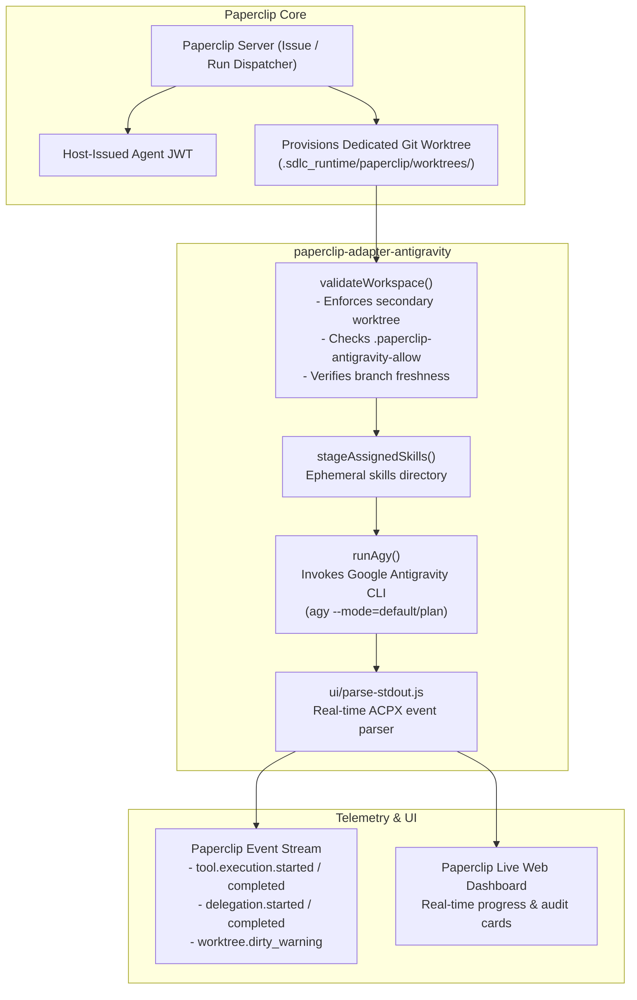

# Paperclip Adapter for Google Antigravity (AGY)

[](https://github.com/nirnaykulshreshtha/paperclip-adapter-antigravity)
[](https://opensource.org/licenses/MIT)
[](https://nodejs.org/)
[](https://github.com/paperclipai)

An official-grade, fail-closed external adapter enabling **[Paperclip AI Agent Orchestration](https://github.com/paperclipai)** to execute autonomous coding tasks through the **Google Antigravity CLI (`agy`)**.

Built for multi-agent enterprise SDLC workflows, this adapter bridges Paperclip's issue boards, role directives, and worktree lifecycles with Antigravity's deep agentic coding capabilities.

---

## Key Features

- **Real-Time Web Dashboard Telemetry**: Streams live progress updates, assistant thoughts, subagent delegations, and tool calls directly to the Paperclip web UI with formatted audit cards.
- **Fail-Closed Workspace Containment**: Strictly enforces Git secondary worktree boundaries. Rejects execution on `main`, `master`, `develop`, or unregistered paths to prevent accidental repository corruption.
- **Deep Tool & Command Audit**: Captures and structures execution details for `run_command`, `invoke_subagent`, file operations, and background tasks.
- **Branch Freshness & Cleanliness Guards**: Warns agents when worktrees fall behind `main`, and detects uncommitted/untracked files at turn completion to prevent stranded deliverables.
- **Multi-Turn Session Persistence**: Seamlessly resumes Antigravity conversation sessions across multi-step tasks while isolating execution workspaces.
- **Ephemeral Skill Staging**: Dynamically stages Paperclip-assigned runtime skills per run without modifying project repositories.
- **Token Usage & USD Cost Ledger**: Calculates input, output, and cached token costs across model tiers to maintain Paperclip company budget compliance.

---

## Architecture & Lifecycle



---

## Prerequisites

1. **Node.js**: `>= 22.16.0`
2. **Paperclip AI**: Installed and configured (`paperclipai run` or source checkout)
3. **Google Antigravity CLI**: Installed and authenticated in your system PATH (`agy --version`)
4. **Git**: Version `2.38+` supporting linked worktrees
5. **Python 3**: Standard library (used on macOS for headless PTY model discovery)

---

## Installation & Setup

### 1. Register Adapter with Paperclip

Add the adapter to your Paperclip instance configuration in `~/.paperclip/adapter-plugins.json`:

```json
[
  {
    "packageName": "paperclip-adapter-antigravity",
    "localPath": "/path/to/paperclip-adapter-antigravity",
    "version": "0.2.12",
    "type": "antigravity_local"
  }
]
```

Or install directly via Paperclip plugin management:

```bash
paperclipai adapter add /path/to/paperclip-adapter-antigravity
```

### 2. Verify Adapter Health

```bash
curl -s http://127.0.0.1:3100/api/adapters | jq '.[] | select(.type=="antigravity_local")'
```

Output:
```json
{
  "type": "antigravity_local",
  "label": "antigravity_local",
  "loaded": true,
  "version": "0.2.12"
}
```

---

## Workspace Configuration & Security Sentinel

To protect projects against unauthorized agent execution, the adapter requires an explicit opt-in sentinel marker in the worktree parent directory:

```bash
# In the parent directory where Paperclip provisions issue worktrees:
printf 'ALLOW_PAPERCLIP_ANTIGRAVITY_LOCAL\n' > /path/to/worktrees/.paperclip-antigravity-allow
```

### Execution Modes

| Mode | Flag | Constraints |
| :--- | :--- | :--- |
| **Planning** | `executionMode: "planning"` | Read-only mode. Fails immediately if the worktree contains uncommitted files or if changes are made during the run. |
| **Implementation** | `executionMode: "implementation"` | Scoped writing. Requires explicit issue authorization. Automatically audits git status on completion and warns if files remain uncommitted. |

---

## Live Dashboard Progress & Telemetry

The adapter includes a dedicated UI parser (`src/ui/parse-stdout.js`) compliant with Paperclip's `adapterUiParser` specification:

- **Command Execution Cards**: Formats command lines, working directory, and outputs in real-time.
- **Subagent Delegations**: Surfaces delegated agent roles (`research`, `self`, `image-generator`) and task summaries.
- **Interactive Progress**: Reports ongoing phases (`startup`, `running_tool`, `finalizing`) with live timestamps.
- **Audited Metrics**: Captures duration, model name, tokens consumed, and estimated cost.

---

## Development & Testing

Run the full suite of unit and integration tests:

```bash
# Run 75+ automated test cases
npm test

# Run strict syntax checks across all modules
npm run check

# Verify live Antigravity models discovery
npm run models:check
```

---

## License

MIT © [Nirnay Kulshreshtha](https://github.com/nirnaykulshreshtha)
